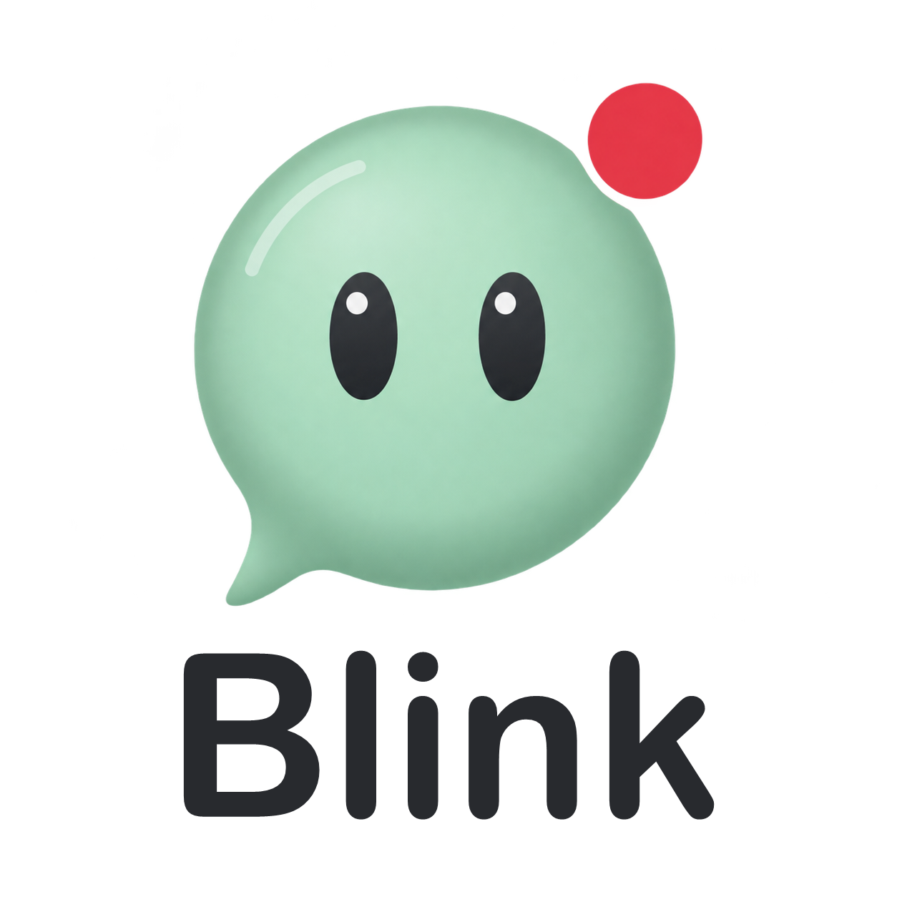

<h1 align="center"></h1>

A small Windows desktop pet that messages you when tasks and deadlines are due. Reminders work offline without a ChatGPT subscription or an API key.

## Get started on Windows

Download the [Windows prototype ZIP](https://github.com/w313nnn/Blink/blob/main/dist/Blink-Windows-Prototype.zip) and extract it. If an older copy is running, right-click its pet and choose **Quit Blink**. Open **Blink.exe** in the extracted folder.

1. Click Blink to open the conversation. Choose **New reminder**, then **Test in 10 seconds**.
2. Choose **Hide** to close the editor. About ten seconds later, a red dot appears on Blink. You can keep working in your current window.
3. Click the pet, type “Got it” and send your reply. You can also close the conversation and reply later. The red dot stays until you answer.

## Set a reminder in chat

Blink understands common requests on its own, including “Remind me to stretch in 20 minutes” and “pls remind to drink water on 2:13pm later”. For a clock time alone, Blink uses the next occurrence in your local time zone and confirms the date.

If you give a date that has passed, you can correct it in your next message. For example, after “drink water on 12:40am 21th November 2026”, a reply of “2026-11-25” changes the date and keeps “drink water” and 12:40 am. If the corrected time has passed too, Blink asks for a future time.

## Manage your checklist

You can send any of these messages to add or change a task.

- “Add a task to review lecture notes”
- “Rename lecture notes to review chapter five”
- “Cancel the review chapter five task”
- “Add a task to submit the art report by tomorrow at noon”

If several tasks match, Blink asks which one you mean. To see what’s coming up, select **Upcoming** or ask “What reminders do I have?”, “What’s due today?” or “What should I work on now?”

Type **open my checklist** or choose **Open checklist file** from the pet’s menu to read your active tasks, deadlines and next reminders. Make changes in the conversation. Blink updates the file and removes a task from the checklist when you mark it done.

## Track an assignment

> My OS report PDF is due in 3 days. Check in with me in 2 hours.

Blink asks for a time if it needs one. Select the report to see the check-in and the deadline. **Snooze 10 min** moves the check-in and keeps the submission deadline. For deadlines more than 30 minutes away, Blink sends a reminder 30 minutes before the deadline and another when it’s due.

Tell Blink “I finished writing” when your draft is ready. The assignment stays on your checklist until you say “I submitted it”. You can also choose **Set manually** to enter dates, add a separate check-in and mark a task as a submission.

## Messages and notifications

Click Blink again or use the chat’s close button to leave the pet floating. To hide the pet too, right-click it and choose **Hide pet**. Blink still receives reminders. To bring it back, right-click its icon in the Windows notification area. You may need to open the hidden-icons arrow first.

Reminders arrive silently. Turn on **Windows notification banners** in the pet’s menu if you also want a Windows notification.

### Earlier messages

By default, Blink shows the current month’s messages, starting on the first. Use the arrows beside the date range to move between periods. For a period with more than one page of messages, use **Older** and **Newer** to read through it.

Click the date range to change your history settings. You can group messages by month, by six months starting in January and July, or by year starting in January. Choose a start day from 1 to 31. If a month is too short for that day, Blink uses its last day. Earlier messages stay available when you change these settings.

## Customize Blink

Click the pet’s picture at the top of the conversation, or right-click the floating pet and choose **Customize pet**. The six pastel swatches are Red, Orange, Yellow, Green, Blue and Purple, in rainbow order. Click a swatch to preview it on the pet and on sample messages. Select **Save** to apply the colour to the floating pet, its tray icon and the whole conversation, including earlier messages.

Hover over Blink to see its eyes curve into a smile. Hold the left mouse button and its eyes widen. Drag it to a new spot and release to set it down. When you change colours or wait for a local AI reply, Blink spins and blinks in the middle of the conversation. If you turn off animation effects in Windows, it holds still there.

You can give Blink a name and choose how it writes reminders. The Calm, Playful and Direct voices work offline. A characteristic such as Sleepy or Energetic changes Blink’s eyes and how often it blinks. You can also enter your own description. Try the ten-second reminder to see how your pet phrases a message.

Blink starts at Small (44 logical pixels). Choose Medium (54) if you prefer a larger pet. Both sizes use the same high-resolution artwork and follow your Windows display scale. Each Windows account has its own pet settings.

## Optional local AI

For less familiar wording, you can use a local chat model. Install Ollama for Windows, run `ollama pull llama3.2:3b` once to download the model, and leave Ollama running. Click the AI status text in the editor to check the connection. Your saved reminders and messages still work when Ollama is off.

## Saved data and startup

Blink stores your tasks, message history and unanswered questions in `%LOCALAPPDATA%\ReminderDot\tasks.json`. It uses `tasks.json` to rebuild the readable checklist at `%LOCALAPPDATA%\ReminderDot\Blink checklist.txt`. Your data stays on this PC. On first launch, Blink imports saved reminders from an older prototype’s `reminders.json` if it finds one.

Keep Blink running and your PC awake to receive reminders on time. Blink delivers overdue reminders when it resumes. To start it automatically, move the executable to its permanent folder and enable **Start when I sign in** in the pet’s menu. If you already enabled this for an older copy, turn it off and back on to update the path.

## Build from source

On Windows with .NET Framework 4.8, run `build.cmd` in the source folder to build `Blink.exe`. To test with an empty profile, set the `BLINK_DATA_DIR` environment variable to an empty test directory before opening Blink.
